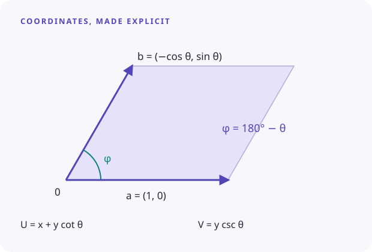

# Coordinates & Fourier conventions

Four details matter when interpreting a model: array order, FFT normalization, the conjugate-pair convention, and the meaning of the reconstruction angle.

## Rows, columns, and mode indices

For a matrix with ``N_v`` rows and ``N_u`` columns, use

```math
u_n = n/N_u,\qquad v_m=m/N_v.
```

The first index of a stored tuple is the **row frequency** ``i``; the second is the **column frequency** ``j``. The field's phase is ``2\pi(jU+iV)``. A transposed matrix exchanges their roles.

```math
c_{ij}=\frac{1}{N_uN_v}\sum_{m=0}^{N_v-1}\sum_{n=0}^{N_u-1}
f_{mn}\exp\!\left[-2\pi\mathrm{i}\left(\frac{im}{N_v}+\frac{jn}{N_u}\right)\right].
```

The imaginary unit in this formula is ``\mathrm{i}``; the ordinary symbol ``i`` is the integer row index. The forward FFT uses a negative exponential and reconstruction uses the corresponding positive-phase convention.

## One tuple per cosine

Real data gives conjugate coefficients ``c_{-i,-j}=c_{ij}^{*}``. A typical conjugate pair contributes

```math
2|c_{ij}|\cos\!\left(2\pi(jU+iV)+\arg c_{ij}\right).
```

The stored tuple is `(i, j, abs(c), angle(c))`. Phase is in **radians**. The magnitude of a non-DC coefficient is **half the cosine amplitude**.

The final tuple must contain the DC coefficient. Its contribution is ``|c_{00}|\cos(\arg c_{00})``, so a negative mean can be represented by a positive magnitude and phase π. A zero mean still requires a final `(0, 0, 0.0, 0.0)` entry in a manually constructed model.

Self-conjugate Nyquist modes need separate treatment. The helper's generic doubling convention is intended for low-frequency ordinary pairs; avoid interpreting Nyquist-edge fits through it without an independent reconstruction check.

## The implemented skew transform

The reconstruction code uses the following map, with θ in **degrees**:

```math
U=x+y\cot\theta,\qquad V=y\csc\theta.
```

```@raw html

```

Its inverse is

```math
\begin{pmatrix}x\\y\end{pmatrix}
=U\begin{pmatrix}1\\0\end{pmatrix}
+V\begin{pmatrix}-\cos\theta\\\sin\theta\end{pmatrix}.
```

For ``0<\theta<180^\circ``, the angle between these two direct-space vectors is **180° − θ**. At θ = 90°, the map reduces to ordinary orthogonal coordinates. θ near 0° or 180° is singular or poorly conditioned.

The [reconstruction tutorial](../tutorials/reconstruction.md) checks this inverse at 60°, 90°, and 120° to floating-point accuracy.

## Shearing an image uses a different parameter

`shear_image(img, θ)` constructs a warp matrix with `tand(θ)`. It operates in the image library's array-coordinate conventions, and its angle is not automatically the angle used by the reconstruction function. The historical image example uses a 30° shear and a 120° reconstruction parameter.

Choose these parameters from a defined geometry and verify the result on known features. Image rotation, the direction of increasing rows, crop boundaries, and phase origin can all matter.

## Coordinate units

The formulas use dimensionless cell coordinates. If an image spans several cells or your Cartesian coordinates have physical units, normalize them consistently before evaluating the model. The package does not infer lattice constants, length units, or an origin from an image.

## Try the angle

This illustration evaluates the two-mode analytic model from Tutorial 03. Adjust θ to see how the pattern and its periodic cell change.

```@raw html
<AngleExplorer />
```
