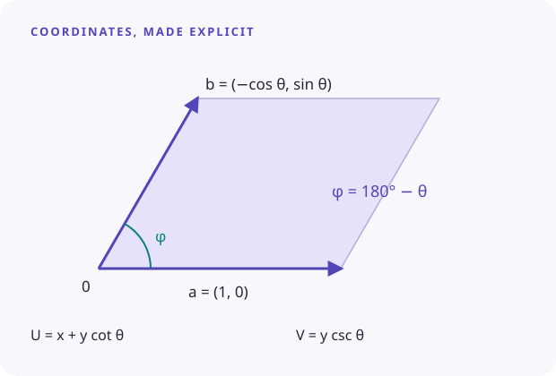

```@raw html
---
layout: home
title: SkewedAxisFourierAnalysis.jl
hero:
  name: SkewedAxisFourierAnalysis.jl
  text: A different angle on Fourier analysis.
  tagline: Turn two-dimensional lattice images into compact harmonic models. Digitize a color map, find the dominant frequencies, and reconstruct the pattern on skewed axes—with Julia you can inspect and run.
  image:
    src: /hero.svg
    alt: A calculated periodic lattice pattern, its Fourier peaks, and a skewed unit cell
  actions:
    - theme: brand
      text: Get started
      link: /guide/getting-started
    - theme: alt
      text: Try the first tutorial
      link: /tutorials/synthetic
features:
  - title: From pixels to values
    details: Match image colors to a supplied colorbar using perceptual color distance. Keep the calibration and its limits explicit.
    link: /tutorials/digitization
    linkText: Digitize an image
  - title: From values to harmonics
    details: Extract normalized Fourier coefficients, reduce conjugate pairs, and save a readable amplitude-and-phase model.
    link: /tutorials/synthetic
    linkText: Explore the spectrum
  - title: Back to skewed space
    details: Evaluate the harmonic model on your own coordinate grid. See exactly how the angle changes the reconstructed pattern.
    link: /tutorials/reconstruction
    linkText: Rebuild the pattern
---
```

```@raw html
<section class="section" aria-labelledby="learn-heading">
  <p class="eyebrow">See the calculation</p>
  <h2 id="learn-heading">Three tutorials. One complete workflow.</h2>
  <p class="intro">Start with a signal whose answer is known. Then learn the image and coordinate steps separately. Every figure below is generated by the Julia script shown in its tutorial.</p>
  <div class="lessons">
    <a class="lesson" href="./tutorials/synthetic.html">
      
      <span class="number">01 / THE SPECTRUM</span><strong>Find the harmonics</strong>
      <span class="detail">Recover a known periodic field, remove a weak ripple, and measure the reconstruction error.</span>
    </a>
    <a class="lesson" href="./tutorials/digitization.html">
      
      <span class="number">02 / THE IMAGE</span><strong>Give pixels a scale</strong>
      <span class="detail">Calibrate a synthetic scientific image against its colorbar before working with a real image.</span>
    </a>
    <a class="lesson" href="./tutorials/reconstruction.html">
      
      <span class="number">03 / THE GEOMETRY</span><strong>Change your perspective</strong>
      <span class="detail">Evaluate one harmonic model at three angles and verify the coordinate transform.</span>
    </a>
  </div>
</section>
<section class="section" aria-labelledby="explore-heading">
  <p class="eyebrow">Explore the geometry</p>
  <h2 id="explore-heading">What changes when the axes tilt?</h2>
  <AngleExplorer />
</section>
<section class="section method-strip" aria-labelledby="method-heading">
  <div>
    <p class="eyebrow">A small model you can read</p>
    <h2 id="method-heading">Keep the pattern.<br>Understand the coordinates.</h2>
    <p class="intro">A real periodic field can be represented by a DC term and a set of cosine modes. The package stores each mode as two integer indices, a magnitude, and a phase. The coordinate guide connects those four numbers to the pattern you see.</p>
    <p class="intro"><a href="./guide/coordinates.html">Read the Fourier conventions →</a></p>
  </div>
  
</section>
<div class="section closing">Already have a numeric matrix? Start directly with <a href="./tutorials/synthetic.html">harmonic extraction</a>. Looking for a function? Open the <a href="./reference/api.html">API reference</a>. This package currently supports real, two-dimensional data.</div>
```
